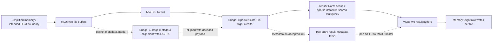

# A Multi-Mode Tensor Core with Shared Multipliers for Dense and Sparse Matrix Multiplication

## 1. Project Overview

This hardware design project implements an **8 x 8 x 8 matrix multiplication tile engine** with signed **INT8 operands and INT32 accumulation**. It combines dense systolic execution and sparse outer-product execution around a shared 8 x 8 multiplier bank, with loading, decoding, flow control, and ordered result writeback implemented in SystemVerilog.

The project demonstrates cycle-level architecture modeling, RTL implementation, pipeline control, resource sharing, and hardware verification. Its engineering focus is preserving numerical correctness, packet order, and precise transfer timing across independently tested modules under backpressure and reset.

**Verified scope:** the five RTL units and their connected system pass the supplied simulation regressions. The memory boundary is a simplified 256-bit interface; a physical HBM controller, complete AXI protocol, board execution, and ASIC implementation are outside the verified scope. Each command computes an independent `C = A x B` tile with zero initial accumulation; there is no accumulation across K tiles or addition of a previous C matrix.

## 2. Key Features and Specification Summary

- Three input modes: dense x dense, unstructured x 2:4, and unstructured x unstructured.
- Dense output-stationary systolic dataflow with lane-dependent input skew.
- Sparse multiply -> route -> accumulate pipeline with consecutive tile overlap.
- One shared bank of 64 signed INT8 multiplication operations in the RTL; separate dense and sparse state and accumulation paths.
- Four-stage DU/TIA decoding and index alignment, followed by an eight-entry packet FIFO with in-flight credit reservation.
- Two Tensor Core result slots, a separate two-entry result-metadata FIFO, and two whole-result buffers in the MSU.
- C reference models, immutable replay vectors, procedural SV scoreboards, and an independent system-level GEMM/writeback check.

### 2.1 System Specification

| Item | Specification |
|---|---|
| Operation | One independent `C = A x B` per command; M=N=K=8; accumulation starts at zero |
| Arithmetic | Signed INT8 operands (−128…127), signed 16-bit products, signed INT32 accumulation/results |
| Input sequence | Eight accepted k packets per tile, ordered `k=0..7`; consistent tile metadata |
| Supported modes | `IO_DENSE=0`: dense × dense; `IO_HYBRID=1`: unstructured A × 2:4 B; `IO_DUAL=2`: unstructured × unstructured; mode 3 is illegal |
| Result | 8×8 INT32 = 64 elements = 256 bytes per tile |
| Tile metadata | 32-bit tile ID and 64-bit destination byte address; preserved in input order |
| Memory addressing | 64-bit source/destination byte addresses, aligned to 32 bytes; the entire burst/result must fit the address range |
| Memory data width | 256 bits = 32 bytes per beat; byte 0 occupies bits [7:0] |
| Clock/reset | Shared rising-edge clock; asynchronous active-low `rst_n`; reset connected modules and pending memory responses together |
| Scope | No old-C addition, cross-K-tile accumulation, physical HBM controller, complete AXI protocol, or built-in shared-memory read/write arbitration |

### 2.2 Component Specifications

The following table consolidates the five units and the integration boundary. Detailed interface definitions and examples are available in the linked English READMEs; legacy filenames are retained to preserve existing links.

| Component | Capacity / datapath | Interfaces and behavior | Detailed documentation |
|---|---|---|---|
| **MLU — Memory Load Unit** | Two tile buffers, each with a 160-byte image capacity; one outstanding read burst | 256-bit memory input; 236-bit DU/TIA packet output plus tile metadata and k. Loads the complete image, then issues eight ordered packets. Holds output stable under backpressure; releases a tile buffer on accepted k=7. Sparse input is already packed. | [MLU specification](mlu_sv/README_zh_TW.md) |
| **DU/TIA — Decompression and Index Alignment** | Four registered stages S0–S3; 236-bit input packet → 185-bit output packet | Dense data forwarding and sparse decoding/index alignment. S0 captures input; S1 forwards/decodes values and predecodes bitmap halves; S2 merges indices; S3 registers output. No downstream `out_ready`; capacity must be reserved before issue. | [DU/TIA specification](du_tia_sv/README.md) |
| **Bridge / Packet FIFO** | Eight packet slots; four-stage metadata pipeline aligned with in-flight DU/TIA packets; separate two-entry result-metadata queue | Tracks `fifo_count + inflight_count <= 8`. Issue reserves capacity, DU arrival transfers occupancy into the FIFO, and TC acceptance releases it. Registered FIFO insertion with a combinational head; no arrival bypass or same-edge credit lookahead when full. | [Bridge specification](fifo_sv/README_zh-TW.md) |
| **Tensor Core** | 8×8 dense systolic path and sparse MUL → ROUTE → ACC path; 64 shared signed multiplication operation positions; two result slots | 185-bit decoded input packet; complete 8×8 INT32 result output. Dense lanes use input skew; sparse tiles can overlap. Reserves result capacity on tile start. Input valid must obey mode-aware readiness; dense/sparse changes require draining prior work/results. | [Tensor Core specification](tensor_core_sv/README_zh_TW.md) |
| **MSU — Memory Store Unit** | Two complete-result buffers, each 256 bytes | Accepts the full matrix and metadata, then writes eight 256-bit rows. Row r uses `dst_addr + 32*r`; each INT32 is little-endian. Holds write payload under stall. `tile_done` occurs only after the final accepted row write. | [MSU specification](msu_sv/README_zhTW.md) |
| **Integration Top** | Connects the five existing units without another data pipeline stage | Exposes command, read-request/data, write, completion, and diagnostic interfaces. Maps package fields explicitly, gates TC valid with mode-aware readiness, and pairs ordered results with Bridge metadata. | [Top-level interface](integration_sv/README_zh_TW.md) |

**Decoded sparse packet contract:** each A/B vector has a 4-bit count (legal values 0…8), eight 8-bit value fields, and eight 3-bit original-coordinate indices. Only entries `0..count-1` are valid, and their indices must be strictly increasing. Stored zero values are legal. Both hybrid and dual modes become `is_sparse=1`; TC does not decode the original 2:4 masks again. See the [DU/TIA types](du_tia_sv/rtl/du_tia_pkg.sv) and [TC types](tensor_core_sv/tensor_core_pkg.sv).

### 2.3 Memory Transfer Sizes

| Input mode / output | Meaningful bytes per tile | Transferred bytes | 32-byte beats |
|---|---:|---:|---:|
| Dense input | 128 | 128 | 4 reads |
| Hybrid input | 120 | 128, including padding | 4 reads |
| Dual-sparse input | 144 | 160, including padding | 5 reads |
| Result output, all modes | 256 | 256 | 8 writes |

These are fixed-size memory images, not variable-length compressed streams. The MLU buffer capacity is 160 bytes per input image; the MSU buffer capacity is 256 bytes per result. The first read-data beat may arrive no earlier than the cycle after request acceptance. The write interface has no separate response channel: `write_ready` denotes acceptance/commit of that beat.

### 2.4 Cycle Timing and Flow-Control Contract

For **TC-local timing**, number the edge accepting k=0 as edge 0, accept k=0…7 consecutively, keep `result_ready=1`, and remain in the same compute mode:

| TC event | Dense | Sparse |
|---|---:|---:|
| Accept k=7 | Edge 7 | Edge 7 |
| Final accumulation | Edge 21 | Edge 9 |
| Publish result (`result_valid` becomes 1 after the edge) | Edge 22 | Edge 10 |
| Earliest result consumption | Edge 23 | Edge 11 |
| Earliest next-tile start | Edge 24 | Edge 8 |

With input gaps, publication occurs 15 edges after the last accepted dense packet or 3 edges after the last accepted sparse packet. Sparse II=8 describes tile starts at the TC boundary with sufficient input and result capacity. **It is not an end-to-end command-to-writeback latency or a guarantee of one memory-completed tile every eight cycles.**

| Boundary / condition | Required behavior |
|---|---|
| MLU issue at edge t | DU/TIA captures S0 at t, then S1/S2/S3 at t+1/t+2/t+3; Bridge inserts the old S3 output at t+4; earliest TC acceptance is t+5 |
| Full packet credit pool | Compute readiness from old registered occupancy; a same-edge TC acceptance cannot fund another issue while full |
| Result-metadata queue | Push on TC acceptance of k=0; block another k=0 when full; pop on the actual TC→MSU result handshake |
| TC input | Present the FIFO head to determine mode-aware `in_ready`; assert `in_valid` only for an eligible, ready transfer. `input_ready` alone is insufficient |
| TC result capacity | Reserve one of two credits on tile start; full capacity blocks a new sparse tile, while an already-started tile can finish |
| MSU completion | Result acceptance into MSU is distinct from writeback completion; completion follows the accepted row 7 write |
| Simulation/driver scheduling | Read pre-edge outputs, determine actual handshakes, then advance every connected module once per edge |

Timing checks are implemented in the [system testbench](integration_sv/tb/tb_sparse_tensor_core_top.sv); archived run evidence is linked in [Section 8](#8-performance-and-implementation-results). Cycle counts do not establish a clock frequency. The archived integrated FPGA run used a 17.000 ns constraint, with the implementation and I/O-constraint limitations stated in that section.

## 3. Overall System Architecture

The system overview follows the data path from memory loading through decoding, buffered computation, and result writeback. "HBM" describes the intended system context; the implemented boundary is a simplified memory interface without an HBM controller.


*System-level overview. Control arrows group related signals; the diagram below separates the Bridge's packet-credit, in-flight metadata, and result-metadata paths.*

<details>
<summary>Implementation dataflow and metadata alignment</summary>



</details>

The top-level module is [`sparse_tensor_core_top`](integration_sv/rtl/sparse_tensor_core_top.sv). It maps fields explicitly between packages and uses mode-aware readiness to turn the FIFO head into an actual Tensor Core acceptance pulse.

## 4. Supported Computation Modes

| Mode | Input representation | Compute dataflow |
|---|---|---|
| `IO_DENSE = 0` | Eight A values and eight B values per k slice | Dense systolic array |
| `IO_HYBRID = 1` | Bitmap/packed A; B uses two retained positions per four K positions, for each output column | Decoded sparse outer product |
| `IO_DUAL = 2` | Bitmap/packed A and B | Decoded sparse outer product |

Mode 3 is illegal. Every tile supplies eight ordered packets, `k=0..7`. Both sparse modes become the same count/value/index representation after DU/TIA. Counts range from 0 to 8, indices are strictly increasing original coordinates, and stored zero values remain legal.

The MLU reads fixed-size images rather than variable-length compressed streams:

| Mode | Meaningful image bytes | Read transfer |
|---|---:|---:|
| Dense | 128 | 4 x 32 bytes |
| Hybrid | 120 | 4 x 32 bytes |
| Dual sparse | 144 | 5 x 32 bytes |

Sparse packing occurs upstream. The MLU loads and packetizes an already encoded image; it does not discover or compress nonzeros.

## 5. Hardware Microarchitecture


*Conceptual compute view. Dense and sparse execution share 64 signed INT8 multiplication operation positions and retain separate accumulation state. The two branches illustrate logical dataflows, not separate multiplier banks. Sparse products pass through index-based routing before accumulation; the Bridge/FIFO between DU/TIA and TC is shown in the system overview above.*

**Dense path.** Regular dense matrices benefit from local operand reuse and predictable nearest-neighbor movement. Lane i is skewed by i cycles, operands propagate across the 8 x 8 PE array, and each PE holds its INT32 accumulator. This implementation drains and consumes a dense result before starting another dense tile.

**Sparse path.** Packed operand ranks do not directly identify output coordinates. Up to `A.count x B.count` products are formed, then routed using the stored row/column indices into the 8 x 8 accumulator matrix. The ROUTE stage uses two combinational selector banks inside the existing pipeline stage. No extra pipeline register is implied by this factorization.

**Shared arithmetic.** The common multiplication loop selects either aligned dense PE operands or sparse packed operands. Products are signed 16-bit values and are sign-extended for INT32 accumulation. Sharing is visible in the RTL structure; it is not a measured area-saving claim against a separately synthesized dual-engine baseline. The archived FPGA reports use LUT logic and report zero DSP blocks.

**Memory units.** MLU has two tile buffers and permits one outstanding read burst. MSU has two complete 256-byte result buffers. It writes eight 32-byte rows in little-endian order and asserts `tile_done` only after the final row transfer. There is no AXI write-response channel in this interface.

## 6. Pipeline and Dataflow

**DU/TIA:** S0 captures the selected input, S1 forwards packed values/decodes 2:4 B and predecodes bitmap halves, S2 merges indices, and S3 registers the output. DU/TIA has no downstream ready input, so capacity must be reserved before issue. The payload passes through DU/TIA, while a separate four-stage metadata pipeline in the Bridge advances in parallel.

**DU/TIA packet metadata alignment:** each Bridge sideband stage tracks `valid`, `is_sparse`, `meta.tile_id`, `meta.dst_addr`, and `k` for the corresponding packet in flight through DU/TIA. These stages carry tags, not the arithmetic payload. When the decoded payload arrives from DU/TIA, the Bridge pairs it with the aligned tile metadata and k and inserts the packet into the FIFO. This per-packet alignment pipeline is distinct from the two-entry result-metadata queue below, which tracks tile results until TC-to-MSU acceptance.

**Packet credits:** `used = fifo_count + inflight_count <= 8`. Issuing into DU/TIA reserves one slot; arrival moves the reservation into the packet FIFO; TC acceptance frees it. Readiness uses the old registered occupancy. A full FIFO cannot borrow a credit from a same-edge dequeue, and newly arriving DU data cannot bypass the FIFO. For an issue at edge t, the earliest TC acceptance is t+5.

**Result metadata:** accepting a k=0 packet into TC enqueues its tile ID and destination address. A full metadata FIFO blocks another k=0. Metadata is removed when TC transfers its result into MSU, independently of later memory write completion.

**Sparse overlap:** first/last markers travel through MUL and ROUTE to ACC. The accumulator clears when the next tile's first packet reaches ACC. Before that clear, the previous completed accumulator is published into a reserved result slot. Thus the next tile can begin MUL while the previous tile is still finishing ROUTE/ACC. New tile starts wait when both result credits are occupied; an already accepted tile can finish safely.

With first TC acceptance numbered edge 0 and eight consecutive packets, the reference/test contract publishes sparse results after edge 10 and dense results after edge 22. Sparse tile starts can be eight cycles apart when inputs and result capacity are available. These are **TC-boundary timings**, not command-to-memory completion latencies. Dense/sparse mode changes wait for the prior mode's outstanding work and results to drain.

## 7. Verification Methodology

Verification proceeds from isolated units to the connected system. Reference models and existing test assertions are preserved.

| Boundary | Checking method |
|---|---|
| MLU | C vectors; pre-edge outputs, events, and all 2,900 state bits |
| DU/TIA | Independent SV packet oracle; directed, all six 2:4 masks at four positions, bitmap enumeration, and deterministic random traffic |
| Bridge | C vectors; all 2,941 state bits, credits, metadata, and rejected-edge behavior |
| Tensor Core | C vectors; readiness/status/events, both complete result slots, and a logical internal-state hash |
| MSU | C vectors; result acceptance, control state, byte order, stalled writes, and final-beat completion |
| Connected RTL | Independent SV matrix generation, memory-image encoding, GEMM, and byte-level writeback scoreboard |

The TC hash is an additional diagnostic, not a formal proof or a full bit-for-bit internal-state comparison. Full result matrices are compared directly. The DU/TIA C model is a separate test program; the DU/TIA SV regression does not call C through DPI. MSU reset/fault handshake suppression is explicitly accounted for by its vector adapter.

Coverage includes signed INT8 extremes, empty/full sparse prefixes, stored zeros, all three modes and all nine mode transitions, FIFO and result saturation, simultaneous push/pop, pointer wrap, memory gaps, held payload stability, and reset/recovery at each targeted occupancy. The tests use procedural checks; they are not a UVM environment, formal equivalence proof, or a claim of exhaustive verification.

## 8. Performance and Implementation Results

The audit reran the existing SV suites on **2026-10-29**, using **ModelSim Intel FPGA Starter Edition 2020.1 / Simulator 2020.02**. Both commands exited successfully; six existing port-kind compilation warnings remain in each suite. See [verification evidence](reports/verification/2026-10-29/README.md). The separate public candidate reproduced these results after vector restoration on [2026-10-30](reports/verification/2026-10-30-packaging/README.md).

| Simulation | Observed result |
|---|---|
| MLU unit | PASS: 16,708 records; 145 resets; 128 expected rejected edges |
| DU/TIA unit | PASS: 3,292 checked packets |
| Bridge unit | PASS: 19,147 records; 7,156 expected rejected edges; 13 resets |
| TC unit | PASS: 136,136 records; 169 resets; 13 expected rejection cases |
| MSU unit | PASS: 8,683 cycles; 676 accepted results; 5,394 beats; 673 completed tiles; 8 resets |
| Connected system | PASS: 316 completed tiles; 3,124 issued packets; 2,563 write beats; 75 resets; seed `91e10da5` |

System totals include partial work deliberately discarded by reset, so packet/beat counts are not simply eight times the completed tile count. The 145 `sparse_II8` observations count TC tile-start intervals, not 145 end-to-end throughput benchmarks.

The standalone C TC benchmark uses **100 tiles of full 8 x 8 outer-product packets**, no input gaps or output stalls, and includes initial fill and final result handshaking. It reports 51,200 MACs: serial scheduling takes 1,200 cycles (66.6667% utilization); overlap takes 804 cycles (99.5025%), a 1.4925x cycle-throughput ratio. Utilization is `MACs / (64 x elapsed cycles)`. This is a controlled full-count sparse-path scheduling experiment, not measured utilization for a pruned network, an HBM workload, or the entire integrated system. Stored zeros count as active work when included in the valid prefix. See [benchmark provenance](docs/verification-and-reproduction.md).

Existing Vivado reports were inspected, **not regenerated**:

| Archived implementation | Phase and constraints | Reported result |
|---|---|---|
| TC alone, 2026-10-19 | FPGA post-route; 12 ns target | WNS -0.238 ns; TNS -2.894 ns; target not met |
| Integrated top, 2026-10-29 | FPGA post-route; 17 ns target | WNS +0.202 ns; TNS 0; specified constraints met |
| Integrated top utilization | Post-place, same archived project | 36,222 LUTs; 22,467 registers; 0 DSPs; 0 block RAM tiles |

Both projects target `xc7z020clg484-1` with Vivado 2022.2 and out-of-context synthesis. The integrated clock target is 58.824 MHz. Its report also records **424 inputs and 592 outputs without delay constraints**, zero BUFGCTRL usage, and a PS7-related DRC warning. Therefore it is not complete board-level timing sign-off or a measured Fmax. Report-to-source commit provenance is not established. See [implementation evidence and limitations](reports/implementation/README.md).

**Not Yet Verified:** maximum operating frequency of the current source, FPGA board/HBM operation, ASIC library/corner PPA, measured power, application-level speedup, and a controlled area comparison quantifying multiplier-sharing savings. The earlier architecture note's approximately 80-83 MHz unplaced ASIC estimate has no supporting ASIC report in the inspected files.

## 9. Repository Structure

Module-local paths are retained so includes, package order, and existing test scripts remain usable.

```text
.
|-- README.md / .gitignore / AGENTS.md
|-- c code/                    # Original C projects, unit tests, VS settings
|-- du_tia_sv/                 # rtl/, tb/, filelist.f, simulation scripts
|-- fifo_sv/                   # Bridge RTL/packages/TB, c_reference/, vectors/
|-- mlu_sv/                    # MLU RTL/packages/TB, c_ref/, vectors, scripts
|-- tensor_core_sv/            # TC RTL/packages/TB, c_reference/, vectors.gz
|-- msu_sv/                    # rtl/, tb/, reference/, vectors/, tools/, sim/
|-- integration_sv/            # Connected top, SV system TB, regression scripts
|-- docs/                      # Architecture notes and source/reproduction audit
|-- reports/
|   |-- verification/          # Reviewed run logs, source hashes and results
|   `-- implementation/        # Selected archived FPGA reports and provenance
|-- tools/                     # Vector restoration and C regression launcher
|-- project_1/                 # Original TC Vivado .xpr / source constraints
`-- project_integration/       # Original top Vivado .xpr / source constraints
```

Legacy documents are retained for context, but may describe earlier package layouts or pre-integration status. Use this README and [source audit](docs/source-audit.md) for current entry points. Generated EDA run trees and private literature/meeting materials are excluded from the proposed public snapshot. Project files retain historical machine-specific settings; they are not a self-contained PPA reproduction flow.

## 10. How to Run the Tests

### ModelSim: units followed by integration

Prerequisites: PowerShell 7 (7.6.5 tested) with permission to run local scripts and the tested ModelSim version (or a compatible simulator, independently verified). Run from the repository root. No C compiler is needed for SV vector replay.

```powershell
# Restore the exact TC vectors from the small gzip distribution.
pwsh -NoProfile -File tools/restore_vectors.ps1

# Runs all five isolated units, checks PASS markers/errors, then runs the top.
pwsh -NoProfile -File integration_sv/sim/run_regression.ps1
```

The first command verifies SHA-256 and refuses to overwrite differing existing vectors. Other unit vectors remain plain text. Windows PowerShell 5.1 may block local scripts under its execution policy; the audit used the already available PowerShell 7 without changing policy. Logs go to `integration_sv/results/`; simulator libraries go to `integration_sv/build/`. To inspect the top alone after establishing a unit baseline:

```powershell
vsim -c -l integration_sv/results/top.log -do integration_sv/sim/run_top.do
```

`run_units.do` compiles each unit separately. `run_top.do` lists the integration packages before modules and selects exactly one DU/TIA package and one TC package. Do not compile all duplicate package files together. The legacy `msu_sv/sim/run_msu.do` has a local absolute path; use the root regression entry point above for portable MSU replay.

### C references

From a Visual Studio Developer Command Prompt with C11 support:

```bat
tools\run_c_tests.bat
```

The launcher builds into `build/c_reference/` and executes the existing TC, MLU, MSU, Bridge, DU/TIA, and basic outer-product C tests. It leaves the original sources, seeds, and replay vectors unchanged. UTF-8 source decoding is required for the DU/TIA source comments. See [commands, results, and limitations](docs/verification-and-reproduction.md).

Optional vector-regeneration scripts already exist in the individual modules. They overwrite vectors/logs, so run them in a separate copy and compare against the published baseline. Verilator and Icarus flows are also included in the original packages; historical results do not imply those tools were rerun in the current Windows audit.

## 11. References

This project is informed by published work on systolic arrays and sparse tensor execution. The implementation and verification artifacts here are the portfolio contribution; the cited architectures, algorithms, and published results remain the work of their respective authors. No paper's benchmark is presented as a result of this project.

1. Chen Zhang et al., **DSTC: Dual-Side Sparse Tensor Core for DNNs Acceleration on Modern GPU Architectures**, IEEE Transactions on Computers, 74(2), 341-355, 2025. [DOI](https://doi.org/10.1109/TC.2024.3475814).
2. Zhi-Gang Liu, Paul N. Whatmough, and Matthew Mattina, **Systolic Tensor Array: An Efficient Structured-Sparse GEMM Accelerator for Mobile CNN Inference**, 2020. [Author preprint](https://arxiv.org/abs/2005.08098).
3. Jun Liu et al., **TSTC: Two-Level Sparsity Tensor Core Enabling both Algorithm Flexibility and Hardware Efficiency**, ICCAD 2023. [DOI](https://doi.org/10.1109/ICCAD57390.2023.10323775).

Only references are intended for the public snapshot; locally stored publisher PDFs and meeting slides are withheld pending redistribution approval. A project-wide redistribution license has not yet been selected by the author.
