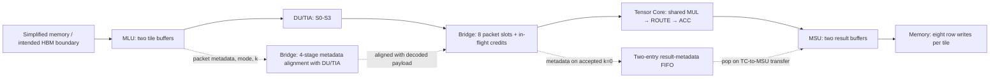

# A Multi-Mode Tensor Core for Dense and Sparse Matrix Multiplication

## 1. Project Overview

This hardware design project implements an **8 x 8 x 8 matrix multiplication tile engine** with signed **INT8 operands and INT32 accumulation**. All three input formats use a shared outer-product Tensor Core. SystemVerilog implements loading, decoding, flow control, signed accumulation and ordered result writeback.

**Major architecture revision: shared dense/sparse compute.** To reduce FPGA resource use, the current design replaces the dedicated dense systolic array and separate sparse compute path with one shared outer-product pipeline. All three modes remain supported. The integrated post-route implementation uses **64 DSPs instead of 128**, with approximately **20% fewer LUTs and 18% fewer registers** than the previous implementation. See the [design rationale](#51-design-decision-replacing-the-dedicated-systolic-array) and [measured comparison](#8-performance-and-implementation-results).

The project demonstrates cycle-level architecture modeling, RTL implementation, pipeline control, resource sharing, and hardware verification. Its engineering focus is preserving numerical correctness, packet order, and precise transfer timing across independently tested modules under backpressure and reset.

**Verified scope:** the five RTL units and their connected system pass the supplied simulation regressions. The memory boundary is a simplified 256-bit interface; a physical HBM controller, complete AXI protocol, board execution, and ASIC implementation are outside the verified scope. Each command computes an independent `C = A x B` tile with zero initial accumulation; there is no accumulation across K tiles or addition of a previous C matrix.

**Current main RTL (2026-11-21).** The adapter writes one indexed operand format into the rotating register FIFO. The Tensor Core consumes the same 184 operand bits for every tile. See the [promotion record and SV diffs](reports/verification/outer_main_20261121/README.md) and [Vivado GUI guide](docs/bram-100mhz-gui.md).

## 2. Key Features and Specification Summary

- Three input modes: dense x dense, unstructured x 2:4, and unstructured x unstructured.
- Dense values bypass sparse decoding and receive fixed indices `0..7` and counts of eight before FIFO insertion.
- One bank of 64 signed multipliers feeds the shared ROUTE and INT32 ACC stages. Consecutive tiles can overlap across source format changes.
- Four-stage DU/TIA decoding and index alignment, followed by an eight-entry packet FIFO with in-flight credit reservation.
- Two Tensor Core result slots, a separate two-entry result-metadata FIFO, and two whole-result buffers in the MSU.
- C reference models, immutable replay vectors, procedural SV scoreboards, and an independent system-level GEMM/writeback check.
- Achieved **100 MHz internal post-route timing closure** for the integrated design on Zynq-7020 (Vivado 2022.2, out-of-context implementation). See [Section 8](#8-performance-and-implementation-results) for detailed results and limitations.

### 2.1 System Specification

| Item | Specification |
|---|---|
| Operation | One independent `C = A x B` per command; M=N=K=8; accumulation starts at zero |
| Arithmetic | Signed INT8 operands (−128…127), signed 16-bit products, signed INT32 accumulation/results |
| Input sequence | Eight accepted k packets per tile, ordered `k=0..7`; consistent tile metadata |
| Supported modes | `IO_DENSE=0`: dense × dense; `IO_HYBRID=1`: unstructured A × 2:4 B; `IO_DUAL=2`: unstructured × unstructured; mode 3 is illegal |
| Result | 8×8 INT32 = 64 elements = 256 bytes per tile |
| Tile metadata | 32-bit tile ID and 64-bit destination byte address; preserved in input order |
| Memory addressing | 64-bit source/destination byte addresses, aligned to 32 bytes; the entire burst/result must fit the address range |
| Memory data width | 256 bits = 32 bytes per beat; byte 0 occupies bits [7:0] |
| Clock/reset | Shared rising-edge clock; asynchronous active-low `rst_n`; reset connected modules and pending memory responses together |
| Scope | No old-C addition, cross-K-tile accumulation, physical HBM controller, complete AXI protocol, or built-in shared-memory read/write arbitration |

### 2.2 Component Specifications

The following table consolidates the five units and the integration boundary. Detailed interface definitions and examples are available in the linked English READMEs.

| Component | Capacity / datapath | Interfaces and behavior | Detailed documentation |
|---|---|---|---|
| **MLU — Memory Load Unit** | Two tile buffers, each with a 160-byte image capacity; one outstanding read burst | 256-bit memory input; 236-bit DU/TIA packet output plus tile metadata and k. Loads the complete image, then issues eight ordered packets. Holds output stable under backpressure; releases a tile buffer on accepted k=7. Sparse input is already packed. | [MLU specification](mlu_sv/README.md) |
| **DU/TIA — Decompression and Index Alignment** | Four registered stages S0–S3; 236-bit input packet → 185-bit output packet | Dense data forwarding and sparse decoding/index alignment. S0 captures input; S1 forwards/decodes values and predecodes bitmap halves; S2 merges indices; S3 registers output. No downstream `out_ready`; capacity must be reserved before issue. | [DU/TIA specification](du_tia_sv/README.md) |
| **Bridge / Packet FIFO** | Eight packet slots; four-stage metadata pipeline aligned with in-flight DU/TIA packets; separate two-entry result-metadata queue | Tracks `fifo_count + inflight_count <= 8`. Issue reserves capacity, DU arrival transfers occupancy into the FIFO, and TC acceptance releases it. Registered FIFO insertion with a combinational head; no arrival bypass or same-edge credit lookahead when full. | [Bridge specification](fifo_sv/README.md) |
| **Tensor Core** | 64 signed INT8 multipliers, index routing, 64 INT32 accumulators, two result slots | A pair of indexed vectors (184 bits). A tile reserves a result slot on its first accepted slice. | [Tensor Core specification](tensor_core_sv/README.md) |
| **MSU — Memory Store Unit** | Two complete-result buffers, each 256 bytes | Accepts the full matrix and metadata, then writes eight 256-bit rows. Row r uses `dst_addr + 32*r`; each INT32 is little-endian. Holds write payload under stall. `tile_done` occurs only after the final accepted row write. | [MSU specification](msu_sv/README.md) |
| **Integration Top** | Connects the five existing units without another data pipeline stage | Exposes command, read-request/data, write, completion, and diagnostic interfaces. Maps package fields explicitly, gates TC valid with result-credit readiness, and pairs ordered results with Bridge metadata. | [Top-level interface](integration_sv/README.md) |

**Decoded sparse packet contract:** each A/B vector has a 4-bit count (legal values 0…8), eight 8-bit value fields, and eight 3-bit original-coordinate indices. Only entries `0..count-1` are valid, and their indices must be strictly increasing. Stored zero values are legal. Both hybrid and dual modes become `is_sparse=1`; TC does not decode the original 2:4 masks again. See the [DU/TIA types](du_tia_sv/rtl/du_tia_pkg.sv) and [TC types](tensor_core_sv/tensor_core_pkg.sv).

### 2.3 Memory Transfer Sizes

| Input mode / output | Meaningful bytes per tile | Transferred bytes | 32-byte beats |
|---|---:|---:|---:|
| Dense input | 128 | 128 | 4 reads |
| Hybrid input | 120 | 128, including padding | 4 reads |
| Dual-sparse input | 144 | 160, including padding | 5 reads |
| Result output, all modes | 256 | 256 | 8 writes |

These are fixed-size memory images, not variable-length compressed streams. The MLU buffer capacity is 160 bytes per input image; the MSU buffer capacity is 256 bytes per result. The first read-data beat may arrive no earlier than the cycle after request acceptance. The write interface has no separate response channel: `write_ready` denotes acceptance/commit of that beat.

### 2.4 Cycle Timing and Flow-Control Contract

For TC-local timing, number the acceptance of k=0 as edge 0. With eight consecutive accepted slices and a ready sink, all three formats have the same timing.

| Event | Edge |
|---|---:|
| Accept k=7 | 7 |
| Earliest next-tile start | 8 |
| Final accumulation | 9 |
| Publish result after the edge | 10 |
| Earliest result consumption | 11 |

Input gaps move publication with the final accepted slice: k=7 + 3 advancing edges. II=8 measures the interval between TC tile starts with available input and result credit.

| Boundary / condition | Required behavior |
|---|---|
| MLU issue at edge t | DU/TIA captures S0 at t, then S1/S2/S3 at t+1/t+2/t+3; Bridge inserts the old S3 output at t+4; earliest TC acceptance is t+5 |
| Full packet credit pool | Compute readiness from old registered occupancy; a same-edge TC acceptance cannot fund another issue while full |
| Result-metadata queue | Push on TC acceptance of k=0; block another k=0 when full; pop on the actual TC→MSU result handshake |
| TC input | Pulse `in_valid` on an eligible head when `in_ready` grants credit. The core consumes only indexed operands. |
| TC result capacity | Reserve one of two credits on tile start; full capacity blocks a new tile, while an already-started tile can finish |
| MSU completion | Result acceptance into MSU is distinct from writeback completion; completion follows the accepted row 7 write |
| Simulation/driver scheduling | Read pre-edge outputs, determine actual handshakes, then advance every connected module once per edge |

Timing checks are implemented in the [system testbench](integration_sv/tb/tb_outer_top.sv); archived run evidence is linked in [Section 8](#8-performance-and-implementation-results). Cycle counts do not establish a clock frequency. The current integrated FPGA implementation meets its 10.000 ns internal post-route timing constraint, with the implementation and I/O-constraint limitations stated in that section.

## 3. Overall System Architecture

The system overview follows the data path from memory loading through decoding, buffered computation, and result writeback. "HBM" describes the intended system context; the implemented boundary is a simplified memory interface without an HBM controller.


*System-level overview. Control arrows group related signals; the diagram below separates the Bridge's packet-credit, in-flight metadata, and result-metadata paths.*

<details>
<summary>Implementation dataflow and metadata alignment</summary>



</details>

The top-level module is [`sparse_tensor_core_top`](integration_sv/rtl/sparse_tensor_core_top.sv). It maps fields explicitly between packages and uses result-credit readiness to turn the FIFO head into an actual Tensor Core acceptance pulse.

## 4. Supported Computation Modes

| Mode | Input representation | Compute dataflow |
|---|---|---|
| `IO_DENSE = 0` | Eight A values and eight B values per k slice | Shared outer product, identity indices |
| `IO_HYBRID = 1` | Bitmap/packed A; B uses two retained positions per four K positions, for each output column | Decoded sparse outer product |
| `IO_DUAL = 2` | Bitmap/packed A and B | Decoded sparse outer product |

Mode 3 is illegal. Every tile supplies eight ordered packets, `k=0..7`. Both sparse modes become the same count/value/index representation after DU/TIA. Counts range from 0 to 8, indices are strictly increasing original coordinates, and stored zero values remain legal.

The MLU reads fixed-size images rather than variable-length compressed streams:

| Mode | Meaningful image bytes | Read transfer |
|---|---:|---:|
| Dense | 128 | 4 x 32 bytes |
| Hybrid | 120 | 4 x 32 bytes |
| Dual sparse | 144 | 5 x 32 bytes |

Sparse packing occurs upstream. The MLU loads and packetizes an already encoded image; it does not discover or compress nonzeros.

## 5. Hardware Microarchitecture

### 5.1 Design Decision: Replacing the Dedicated Systolic Array

The previous implementation used an 8 x 8 systolic array for dense tiles and a separate outer-product path for sparse tiles. Selecting a path by mode still left two multiplier banks instantiated in hardware: the integrated design used 128 DSP48E1 blocks. Reducing this hardware resource cost motivated the move to a common compute pipeline.

The current design expresses every k slice as an outer product. Dense operands receive identity indices and counts of eight; sparse operands retain their decoded indices and counts. Both then use the same 64 signed multipliers, ROUTE stage, INT32 accumulators and result slots. Dense matrix multiplication remains fully supported, and the production core no longer needs a dedicated systolic array or a compute-mode input.

This revision also changes dense timing and format switching. The retained [old/new benchmark log](reports/verification/outer_main_20261121/units.log) records an unstalled dense tile-start interval of 24 cycles for the predecessor and eight for the shared core. Dense, sparse and mixed streams now use the same pipeline timing, with tile overlap across format changes. The top-level memory interfaces and independent 8 x 8 x 8 operation remain unchanged.

The design tradeoff is that dense execution also traverses the index-routing network. The resource and cycle improvements apply to this tile engine and its measured predecessor; they do not establish that outer-product architectures are universally preferable to systolic arrays. Section 8 compares integrated post-route resources under matching implementation constraints.

### 5.2 Shared Pipeline and Memory Units

The DU/TIA forwards dense operands in lane order. At FIFO ingress the adapter assigns both dense vectors a count of eight and identity indices, including lanes containing zero. It forwards the decoded indices/counts for hybrid and dual inputs. The Bridge checks the original format tag at arrival. Only the two indexed vectors reach the compute core.

Each k slice drives 64 signed INT8 multipliers. Two eight-way selector banks map valid products back to the original columns and rows. The accumulator sign-extends each 16-bit product and accumulates it into an INT32 result. First-slice clearing and last-slice publication use registered markers so tiles can overlap.

**Memory units.** MLU has two tile buffers and permits one outstanding read burst. MSU has two complete 256-byte result buffers. It writes eight 32-byte rows in little-endian order and asserts `tile_done` only after the final row transfer. There is no AXI write-response channel in this interface.

<a id="6-pipeline-and-dataflow"></a>

## 6. End-to-End Execution Flow and Pipeline Control

### 6.1 End-to-End Execution Flow

For a legal tile command without reset, the system follows the path shown in [Section 3](#3-overall-system-architecture): command acceptance → MLU memory reads → DU/TIA decoding → Bridge buffering → TC computation → MSU row writes → completion.

1. **Accept the command.** A `command_valid && command_ready` handshake assigns a free MLU tile buffer. The command contains the compute mode, one `src_addr` for the memory image containing both A and B, and `meta.tile_id` / `meta.dst_addr` for identifying and writing the result.

2. **Load the complete input image.** MLU issues a read burst and accepts 32-byte beats into the assigned buffer. Dense and hybrid images require four beats; dual-sparse images require five. Only one read burst may be outstanding. After the final beat is accepted and the image passes format checks, the tile becomes ready for packet output. Sparse data is already packed in memory.

3. **Issue eight ordered packets.** MLU presents `k=0..7` from the ready head buffer. Each actual issue requires Bridge credit and sends the payload to DU/TIA while sending its mode, k, and tile metadata to the Bridge's parallel metadata pipeline. If credit is unavailable, MLU holds the current packet stable. Accepted k=7 releases the MLU buffer for reuse, even while that tile is still computing or awaiting writeback.

4. **Decode, align, and queue.** DU/TIA forwards dense operands or decodes sparse values and original-coordinate indices through S0–S3. The adapter normalizes the operands before the Bridge pairs the payload with its aligned metadata and inserts it into the packet FIFO. Packets leave in order when TC is ready and the metadata admission rules allow acceptance; accepting k=0 also records the tile ID and destination address in the result-metadata FIFO.

5. **Compute the result.** TC consumes the eight k packets using the shared outer-product pipeline, accumulating an independent `C = A x B` tile from zero. The completed 8×8 INT32 matrix is published in a TC result slot and remains available until the downstream result handshake.

6. **Transfer the result into MSU.** When the TC result, matching Bridge metadata, and MSU capacity are available, one handshake transfers the full matrix and metadata into an MSU result buffer. That same edge removes the Bridge result-metadata entry and releases the TC result slot. MSU now owns the buffered result and its writeback address.

7. **Write eight rows and report completion.** MSU writes rows 0–7 in order, one 32-byte beat per row at `dst_addr + 32*r`, with each INT32 stored little-endian. A beat commits only on `write_valid && write_ready`; stalled writes hold their payload and address. After row 7 is accepted, the registered `tile_done` pulse and `completed` metadata identify the finished tile. This simplified interface has no separate write-response channel.

These steps describe one tile's progress. Different stages can work on different tiles concurrently: MLU can load one buffer while issuing from the other, and MSU can write an older result while upstream stages process later work, subject to buffer capacity, memory availability and result credit.

### 6.2 Pipeline and Flow Control

**DU/TIA:** S0 captures the selected input, S1 forwards packed values/decodes 2:4 B and predecodes bitmap halves, S2 merges indices, and S3 registers the output. DU/TIA has no downstream ready input, so capacity must be reserved before issue. The payload passes through DU/TIA, while a separate four-stage metadata pipeline in the Bridge advances in parallel.

**DU/TIA packet metadata alignment:** each Bridge sideband stage tracks `valid`, `is_sparse`, `meta.tile_id`, `meta.dst_addr`, and `k` for the corresponding packet in flight through DU/TIA. These stages carry tags, not the arithmetic payload. When the decoded payload arrives from DU/TIA, the Bridge pairs it with the aligned tile metadata and k and inserts the packet into the FIFO. This per-packet alignment pipeline is distinct from the two-entry result-metadata queue below, which tracks tile results until TC-to-MSU acceptance.

**Packet credits:** `used = fifo_count + inflight_count <= 8`. Issuing into DU/TIA reserves one slot; arrival moves the reservation into the packet FIFO; TC acceptance frees it. Readiness uses the old registered occupancy. A full FIFO cannot borrow a credit from a same-edge dequeue, and newly arriving DU data cannot bypass the FIFO. For an issue at edge t, the earliest TC acceptance is t+5.

**Result metadata:** accepting a k=0 packet into TC enqueues its tile ID and destination address. A full metadata FIFO blocks another k=0. Metadata is removed when TC transfers its result into MSU, independently of later memory write completion.

**Tile overlap:** first/last markers travel through MUL and ROUTE to ACC. The accumulator clears when the next tile's first packet reaches ACC. Before that clear, the previous completed accumulator is published into a reserved result slot. Thus the next tile can begin MUL while the previous tile is still finishing ROUTE/ACC. New tile starts wait when both result credits are occupied; an already accepted tile can finish safely.

**Writeback backpressure:** when memory stalls, MSU retains the current row. If both MSU buffers fill, TC-to-MSU transfers wait; occupied TC result slots then block new tile starts. As packets accumulate in the Bridge, its credit limit eventually stops further MLU issues. Already-issued DU/TIA packets still have reserved FIFO space, so the fixed pipeline can finish safely.

### 6.3 Timing Boundaries

**Packet transit:** an MLU issue at edge t is captured in DU/TIA S0 on that edge, reaches S3 at t+3, and is inserted into the Bridge FIFO at t+4. Its earliest TC acceptance is t+5; input gaps or downstream stalls can delay acceptance.

**TC computation:** every format publishes at k=7 + 3 advancing edges. A new tile may start eight cycles after the previous start, including a change of input format. See [Section 2.4](#24-cycle-timing-and-flow-control-contract).

**System completion:** result publication, TC-to-MSU acceptance, and memory writeback completion are separate events. End-to-end latency is measured from the accepted command to the final accepted row write, reported by `tile_done`. It includes memory-read latency and gaps, packet issue stalls, computation, result-buffer waits, and all eight accepted row writes. There is no single fixed end-to-end cycle count under arbitrary backpressure; II=8 applies to TC tile starts, not completed memory writebacks.

## 7. Verification Methodology

Verification proceeds from isolated units to the connected system. Reference models and existing test assertions are preserved.

| Boundary | Checking method |
|---|---|
| MLU | C vectors; pre-edge outputs, events, and all 2,900 state bits |
| DU/TIA | Independent SV packet oracle; directed, all six 2:4 masks at four positions, bitmap enumeration, and deterministic random traffic |
| Bridge | C vectors; all 2,941 state bits, credits, metadata, and rejected-edge behavior |
| Tensor Core | Outer-product windows from the original C vectors compare readiness, status, tick events and both complete result slots. A directed credit test checks rejection while a result pop is requested. |
| MSU | C vectors; result acceptance, control state, byte order, stalled writes, and final-beat completion |
| Connected RTL | Independent SV matrix generation, memory-image encoding, GEMM, and byte-level writeback scoreboard |

The DU/TIA C model is a separate test program; the DU/TIA SV regression does not call C through DPI. MSU reset/fault handshake suppression is explicitly accounted for by its vector adapter.

Coverage includes signed INT8 extremes, empty/full sparse prefixes, stored zeros, all three modes and all nine mode transitions, FIFO and result saturation, simultaneous push/pop, pointer wrap, memory gaps, held payload stability, and reset/recovery at each targeted occupancy. The tests use procedural checks; they are not a UVM environment, formal equivalence proof, or a claim of exhaustive verification.

## 8. Performance and Implementation Results

The [current verification record](reports/verification/outer_main_20261121/README.md) links the main-source simulation and native Vivado implementation evidence.

| TC benchmark, 24 tiles, always-ready sink | Prior production cycles | Unified core cycles |
|---|---:|---:|
| Dense | 576 | 196 |
| Full-count indexed | 196 | 196 |
| Alternating dense / full-count indexed | 432 | 196 |

The benchmark counts from first input acceptance through final result consumption. The connected regression checks GEMM and each written byte across all nine mode transitions, memory stalls, resets and full result buffers.

The previous and current integrated `sparse_tensor_core_top` builds use Vivado 2022.2, `xc7z020clg484-1`, a 10.000 ns OOC clock, and default placement and routing. The following **post-route** measurements compare the previous BRAM implementation with separate compute paths against the shared core:

| Integrated metric | Previous dense/sparse paths | Shared outer-product core | Change |
|---|---:|---:|---:|
| DSP48E1 blocks | 128 | 64 | -50.0% |
| Slice LUTs | 28,213 | 22,581 | -20.0% |
| Slice registers | 19,852 | 16,281 | -18.0% |
| RAMB36E1 blocks | 18 | 18 | Unchanged |
| Setup WNS at 10 ns | +0.011 ns | +0.162 ns | Both meet the constraint |

Sources: [previous routed utilization](experiments/mlu_bram_100mhz_20261118/rotating_fifo/flow/initial/utilization_routed.rpt), [current native utilization](reports/verification/outer_main_20261121/native/independent_checkpoint/utilization.rpt), and the [timing and implementation comparison](reports/verification/outer_main_20261121/README.md#resource-use-and-timing). These are integrated hardware resource counts. The [GUI and rebuild guide](docs/bram-100mhz-gui.md) identifies the active runs. Board I/O timing and power are outside these measurements.

## 9. Repository Structure

Module-local paths are retained so includes, package order, and existing test scripts remain usable.

```text
.
|-- README.md / .gitignore / AGENTS.md
|-- c code/                    # Original C projects, unit tests, VS settings
|-- du_tia_sv/                 # rtl/, tb/, filelist.f, simulation scripts
|-- fifo_sv/                   # Bridge RTL/packages/TB, c_reference/, vectors/
|-- mlu_sv/                    # MLU RTL/packages/TB, c_ref/, vectors, scripts
|-- tensor_core_sv/            # TC RTL/packages/TB, c_reference/, vectors.gz
|-- msu_sv/                    # rtl/, tb/, reference/, vectors/, tools/, sim/
|-- integration_sv/            # Connected top, SV system TB, regression scripts
|-- docs/                      # Architecture notes and source/reproduction audit
|-- reports/
|   |-- verification/          # Reviewed run logs, source hashes and results
|-- experiments/               # RTL snapshots, physical recipes and measured evidence
|-- tools/                     # Vector restoration, C regression and 10 ns build flows
`-- project_integration/       # Original top Vivado .xpr / source constraints
```

Legacy documents are retained for context, but may describe earlier package layouts or pre-integration status. Use this README and the [BRAM GUI guide](docs/bram-100mhz-gui.md) for current implementation entry points. Generated EDA run trees and private literature/meeting materials are excluded from this public repository. Project files retain historical machine-specific settings; use the BRAM scripts linked in Section 8 to rebuild the implementation. The obsolete standalone `project_1` project and older native retry runs had been removed before this promotion; dated text evidence is retained.

The [historical publication validation](reports/verification/2026-11-13-native-publication/README.md)
records the pre-BRAM source snapshot, regression rerun, and removed superseded reports.
Historical local commit IDs in experiment records may not exist in the public Git history.

For preserved predecessor material, start with the
[pre-BRAM archive guide](backups/pre_bram_20261119/README.md) and
[result-banking cleanup guide](experiments/msu_fmax/result_bank_20261115/cleanup_20261115/README.md).
These dated guides identify the old dense/sparse architecture, retain original
hash-verified snapshots, and provide maintained navigation to historical evidence
and explicitly labeled current references.

## 10. How to Run the Tests

### ModelSim: units followed by integration

Prerequisites: PowerShell 7 (7.6.5 tested) with permission to run local scripts and the tested ModelSim version (or a compatible simulator, independently verified). Run from the repository root. No C compiler is needed for SV vector replay.

```powershell
# Restore the exact TC vectors from the small gzip distribution.
pwsh -NoProfile -File tools/restore_vectors.ps1

# Runs the five isolated units and the old/new TC benchmark, then the top.
pwsh -NoProfile -File integration_sv/sim/run_regression.ps1
```

The first command verifies SHA-256 and refuses to overwrite differing existing vectors. Other unit vectors remain plain text. Windows PowerShell 5.1 may block local scripts under its execution policy; the audit used the already available PowerShell 7 without changing policy. Logs go to `integration_sv/results/`; simulator libraries go to `integration_sv/build/`. To inspect the top alone after establishing a unit baseline:

```powershell
vsim -c -l integration_sv/results/top.log -do integration_sv/sim/run_top.do
```

`run_units.do` compiles each unit separately. `run_top.do` lists the integration packages before modules and selects exactly one DU/TIA package and one TC package. Do not compile all duplicate package files together. The legacy `msu_sv/sim/run_msu.do` has a local absolute path; use the root regression entry point above for portable MSU replay.

### C references

From a Visual Studio Developer Command Prompt with C11 support:

```bat
tools\run_c_tests.bat
```

The launcher builds into `build/c_reference/` and executes the existing TC, MLU, MSU, Bridge, DU/TIA, and basic outer-product C tests. It leaves the original sources, seeds, and replay vectors unchanged. UTF-8 source decoding is required for the DU/TIA source comments. See [commands, results, and limitations](docs/verification-and-reproduction.md).

Optional vector-regeneration scripts already exist in the individual modules. They overwrite vectors/logs, so run them in a separate copy and compare against the published baseline. Verilator and Icarus flows are also included in the original packages; historical results do not imply those tools were rerun in the current Windows audit.

## 11. References

This project is informed by published work on systolic arrays and sparse tensor execution. The implementation and verification artifacts here are the portfolio contribution; the cited architectures, algorithms, and published results remain the work of their respective authors. No paper's benchmark is presented as a result of this project.

1. Chen Zhang et al., **DSTC: Dual-Side Sparse Tensor Core for DNNs Acceleration on Modern GPU Architectures**, IEEE Transactions on Computers, 74(2), 341-355, 2025. [DOI](https://doi.org/10.1109/TC.2024.3475814).
2. Zhi-Gang Liu, Paul N. Whatmough, and Matthew Mattina, **Systolic Tensor Array: An Efficient Structured-Sparse GEMM Accelerator for Mobile CNN Inference**, 2020. [Author preprint](https://arxiv.org/abs/2005.08098).
3. Jun Liu et al., **TSTC: Two-Level Sparsity Tensor Core Enabling both Algorithm Flexibility and Hardware Efficiency**, ICCAD 2023. [DOI](https://doi.org/10.1109/ICCAD57390.2023.10323775).

The public repository includes bibliographic references; locally stored publisher PDFs and meeting slides are not included. A project-wide redistribution license has not yet been selected by the author.
